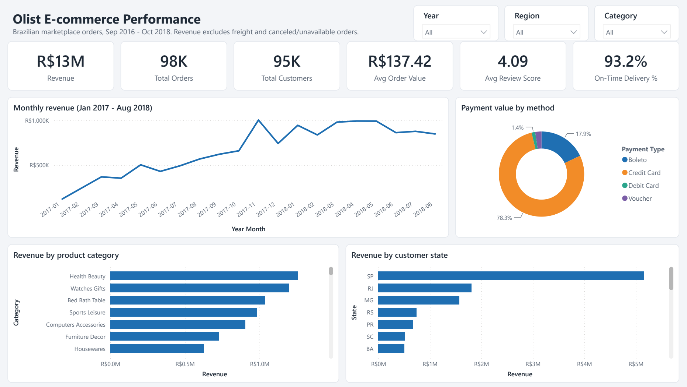
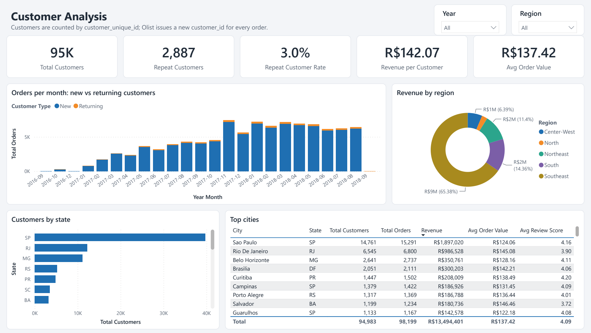
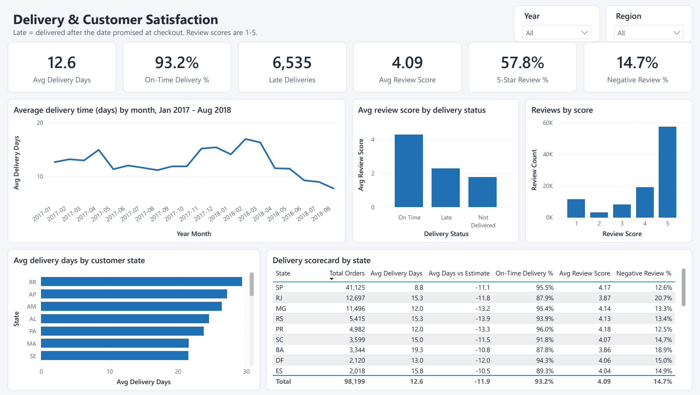
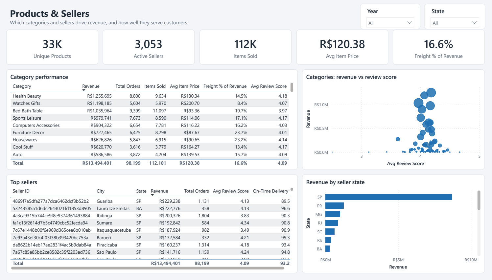
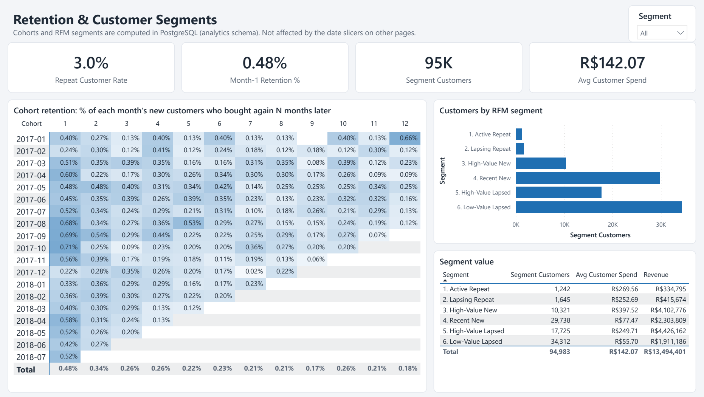

# E-commerce Sales & Customer Analytics

An end-to-end BI project on the [Brazilian E-Commerce Public Dataset by Olist](https://www.kaggle.com/datasets/olistbr/brazilian-ecommerce): about 100k orders placed on a Brazilian marketplace between 2016 and 2018.

**Python ETL → PostgreSQL star schema (DDL + SQL) → analytical SQL views → Power BI report**, plus a statistics notebook that tests what drives bad reviews.

| Layer | What's here | Tools |
|---|---|---|
| Ingestion | Bulk-loads 9 CSVs (1.5M rows) into a raw `staging` schema | Python, psycopg `COPY` |
| Warehouse | Typed star schema with PK/FK/CHECK constraints | PostgreSQL DDL |
| Transformation | Cleaning, delivery metrics, customer order sequence | SQL (CTEs, window functions) |
| Analytics | 7 business-question views: trends, cohorts, RFM, Pareto | SQL (LAG, NTILE, RANK, running totals) |
| Testing | 17 data-quality tests: completeness, reconciliation, business rules | pytest |
| Statistics | t-test, chi-squared, OLS and logistic regression | SciPy, statsmodels |
| Reporting | 5-page report with 34 DAX measures | Power BI (PBIP: TMDL + PBIR) |



<details>
<summary><b>More report pages</b> (or view the <a href="docs/OlistAnalytics-report.pdf">full PDF export</a>)</summary>

**Customers**


**Delivery & Reviews**


**Products & Sellers**


**Retention & Segments**


</details>

## Key findings

- **Late delivery is the biggest driver of bad reviews.** Late orders average **2.27★** vs **4.29★** for on-time ones (Welch's t = −100.7, p < 0.001, Cohen's d = −1.7). A late order is **6.8× more likely** to get a 1-2 star review (χ² = 15,078, p < 0.001).
- **Customers judge the broken promise, not the wait.** Scores stay at about 4.3 however early an order arrives, then fall to about 3.0 within 1-5 days of missing the estimate and to below 1.8 after that. In the regression, being late costs **1.5 stars** even with delivery time held constant.
- **Multi-seller baskets hurt.** Each additional seller in an order costs about **1 star**, because split shipments are a clear pain point.
- **Freight and price don't drive reviews directly.** Freight's apparent effect disappears once delivery is controlled for (confounding).
- **Retention is close to zero.** Only 3% of customers ever reorder, and month-1 cohort retention is **0.48%**. The largest revenue segment is *High-Value Lapsed* customers (R$ 4.4M), an obvious win-back target.
- **Seller revenue is concentrated.** **17.7%** of sellers generate 80% of revenue (Pareto).
- **Delivery is slow in the North.** Roraima, Amapá and Amazonas average 26-29 days, vs 8.8 in São Paulo.

## Architecture

```
archive.zip ─► etl/load_warehouse.py ─► PostgreSQL (Docker)
                                         ├─ staging    raw text tables (COPY)
                                         ├─ dw         star schema  ◄── Power BI imports
                                         └─ analytics  SQL views    ◄── Power BI + notebook
```

**Star schema (`dw`)**

```
            dim_date ──┐
                       ▼
dim_customer ──► fact_orders ◄── fact_payments
                   ▲    ▲
                   │    └──── fact_reviews
                   │
           fact_order_items ──► dim_product
                   └──────────► dim_seller
```

## Quick start

Prerequisites: Docker Desktop, Python 3.10+, Power BI Desktop.

The raw data isn't committed: download the dataset from [Kaggle](https://www.kaggle.com/datasets/olistbr/brazilian-ecommerce) and save it as `archive.zip` in the project root.

```bash
# 1. Database (PostgreSQL 17 on localhost:5434, user/password olist / olist_local)
docker compose up -d

# 2. Python environment
python -m venv .venv
.venv\Scripts\activate            # macOS/Linux: source .venv/bin/activate
pip install -r requirements.txt

# 3. Build the warehouse (unzips archive.zip if needed, ~25 s)
set PGHOST=localhost& set PGPORT=5434& set PGUSER=olist& set PGPASSWORD=olist_local
python etl/load_warehouse.py      # PowerShell: $env:PGHOST="localhost"; $env:PGPORT="5434"; ...

# 4. Data-quality tests
pytest -q

# 5. Statistics notebook
jupyter notebook analysis/statistical_analysis.ipynb
```

**Open the report:** double-click `OlistAnalytics.pbip`, then click **Refresh**.
- When prompted for credentials, choose **Database**, user `olist`, password `olist_local`.
- If you get an SSL or encryption error, the local container doesn't use SSL. Go to **File → Options and settings → Data source settings → Edit permissions** and untick **Encrypt connections**.
- To point at a different server, use **Transform data → Edit parameters** (`PgServer`, `PgDatabase`).

## Repository layout

```
docker-compose.yml               PostgreSQL 17 container
requirements.txt
etl/load_warehouse.py            extract → COPY into staging → run SQL build scripts
sql/
  01_staging.sql                 raw landing tables (all TEXT)
  02_warehouse_ddl.sql           star schema DDL: PK / FK / CHECK constraints, indexes
  03_transform.sql               staging → dw (typing, cleaning, window functions)
  04_analytics_views.sql         business-question views
tests/test_warehouse.py          17 pytest data-quality checks
analysis/statistical_analysis.ipynb
OlistAnalytics.pbip              ← open in Power BI Desktop
OlistAnalytics.SemanticModel/    TMDL: tables, relationships, DAX measures
OlistAnalytics.Report/           PBIR: one JSON file per page and visual
```

## SQL layer

**Data-quality fixes in the transform**
- Two product categories are missing from Olist's own translation file. They are patched, so the only "Uncategorized" products (610) are ones with no category at all.
- `review_id` is not unique in the source, so the primary key is `(review_id, order_id)`.
- The geolocation file (1M rows) is collapsed to one centroid per zip prefix, and points outside Brazil are dropped.
- Olist issues a new `customer_id` for every order. A `ROW_NUMBER()` window over `customer_unique_id` gives each person's order sequence and labels each order as New or Returning.

**Analytics views (`sql/04_analytics_views.sql`)**

| View | Business question | SQL techniques |
|---|---|---|
| `monthly_revenue` | How is revenue trending MoM / YoY? | Month spine, `LAG`, 3-month moving average, running total |
| `cohort_retention` | What share of each month's new customers comes back? | CTE chain, `age()`, `FIRST_VALUE` |
| `customer_rfm` | Which customers should marketing target? | `NTILE` scoring, rule-based segments |
| `seller_ranking` | Who are the top sellers, and how concentrated is revenue? | `RANK` (overall and per state), `NTILE`, cumulative share |
| `category_performance` | Which categories drive revenue and satisfaction? | `DENSE_RANK`, share of total |
| `delivery_by_state` | Where is delivery slow? | Aggregate window `RANK` |
| `order_review_features` | Modelling table for the notebook | Pre-aggregated CTEs |

**Tests (`tests/test_warehouse.py`)** check that:
- Row counts match staging.
- Revenue and payments reconcile to the cent against the raw files.
- Every product has a category, and every order date is in the calendar.
- Each customer has exactly one "New" order.
- Cohort month 0 is 100% retention.
- The seller Pareto curve reaches 100%.

## Statistics (`analysis/statistical_analysis.ipynb`)

| Test | Result |
|---|---|
| Welch's t-test, review score late vs on time (+ Mann-Whitney U) | −2.02 stars, 95% CI [−2.06, −1.98], p < 0.001, d = −1.7 |
| Chi-squared, late × 1-2 star review | χ² = 15,078, p < 0.001, Cramér's V = 0.40, relative risk 6.8 |
| OLS: score ~ delivery days + freight + price (HC3 SEs) | −0.045 stars per delivery day; price not significant; R² = 0.11 |
| OLS + lateness and basket size | Late −1.54, each extra seller −1.06, freight no longer significant; R² = 0.20 |
| Logistic: P(1-2 star review) | Late odds ratio 8.2; each extra seller odds ratio 5.1 |

The notebook ends with recommendations (set delivery estimates from percentiles rather than averages; consolidate multi-seller shipments) and caveats (observational data, not causal).

## Power BI report

Five pages:
1. **Executive Overview:** KPI cards, monthly revenue, payment mix, revenue by category and state.
2. **Customers:** unique vs repeat customers, new vs returning orders, regions, top cities.
3. **Delivery & Reviews:** delivery trend, review score by delivery status, state scorecard.
4. **Products & Sellers:** category table, revenue vs review scatter, top sellers.
5. **Retention & Segments:** cohort retention matrix, RFM segment size and value.

**Model design.**
- Single-direction relationships throughout.
- Delivery, review and customer measures turn on `CROSSFILTER(... BOTH)` only inside the measure, so slicing by product or seller still gives correct review and delivery numbers.
- Revenue = item price, excluding freight, on orders that are not canceled or unavailable.

**Expected values with no filters applied** (also asserted in the tests): Revenue R$ 13.49M · Orders 98,199 · Customers 94,983 · Avg order value R$ 137.42 · Avg review 4.09 · On-time 93.2%.

> The source data has only a handful of orders in late 2016 and Sep–Oct 2018. The revenue and delivery trend charts therefore show Jan 2017 – Aug 2018. The new-vs-returning orders chart shows every month, so it drops off at the end; that isn't a real decline.

## Publishing (Power BI Service)

1. **Sign in.** Power BI Service needs a work or school account; personal Gmail or Outlook addresses aren't accepted. A university email usually works.
2. **Publish.** In Desktop: **Home → Publish → My workspace**. The report and its imported data upload together.
3. **Refresh (optional).** Scheduled refresh from a database on `localhost` needs the **on-premises data gateway (personal mode)** installed on your PC. Without it, the published report stays a snapshot, which is fine for a portfolio.
4. **Share.** **File → Embed report → Publish to web** gives a public link, if your tenant admin allows it. Otherwise share it with specific people, or record a short walkthrough video.

**Updating the screenshots:** in Desktop, go to **File → Export → Export to PDF** and save the file as `docs/OlistAnalytics-report.pdf`. Then run `python docs/render_screenshots.py`. It renders each page to `docs/screenshots/` and crops it to the report canvas, which removes any Desktop side pane captured in the export.
